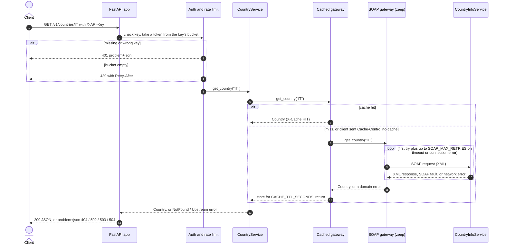

# soap-rest-gateway

A small, production-style **REST/JSON API in front of a public SOAP web service**.

It wraps the free [CountryInfoService](http://webservices.oorsprong.org/websamples.countryinfo/CountryInfoService.wso?WSDL)
(countries, continents, currencies, languages) and exposes it as a clean, documented REST API:
JSON instead of XML, proper HTTP status codes, pagination and filtering, and the operational
features a real integration needs: API-key authentication, per-key rate limiting, a response
cache, timeouts with retries, structured logs and health probes.

I built it as a portfolio project to show API design, legacy-system integration and DevOps
basics. Only public data is used. Every design choice is explained in
[`docs/DECISIONS.md`](docs/DECISIONS.md).

**Stack:** Python 3.11+, FastAPI, zeep (SOAP client), Pydantic, pytest, Docker, GitHub Actions.

## Quick start

You need Docker with Compose. One command creates a config file with a random API key and starts the service:

```bash
echo "API_KEYS=$(openssl rand -hex 24)" > .env && docker compose up --build
```

Then open **<http://localhost:8000/docs>** for the interactive OpenAPI documentation
(use the *Authorize* button with the key from `.env`), or use curl:

```bash
export KEY=$(grep ^API_KEYS= .env | cut -d= -f2)
curl -s -H "X-API-Key: $KEY" localhost:8000/v1/countries/IT
```

`.env.example` lists every setting. The app refuses to start without a key, and refuses the
`change-me...` placeholder from that file.

## How a request flows



The code follows the same layers, and each layer only knows the one below it:

| Layer | Folder | Knows about |
|---|---|---|
| HTTP | `app/api/` | routes, status codes, headers, auth |
| Business logic | `app/domain/` | models, filtering, pagination, errors (no zeep, no HTTP) |
| Caching | `app/infra/` | cache and rate limiter, behind small interfaces |
| SOAP | `app/soap/` | zeep, WSDL, the quirks of this one upstream |

## API

All `/v1` routes need the `X-API-Key` header. `/health`, `/health/ready` and `/docs` are public.

| Method and path | Description |
|---|---|
| `GET /v1/countries` | List countries. Filters: `continent`, `currency`, `q` (name contains). Paging: `limit` (1-250), `offset` |
| `GET /v1/countries/{code}` | One country by ISO code (`IT`, case-insensitive) |
| `GET /v1/continents` | List continents |
| `GET /v1/currencies` | List currencies |
| `GET /v1/currencies/{code}/countries` | Countries that use a currency (`EUR`) |
| `GET /health` | Liveness: the process is up (never calls upstream) |
| `GET /health/ready` | Readiness: the upstream SOAP service answers (200 or 503) |

### Examples

A country:

```console
$ curl -s -H "X-API-Key: $KEY" localhost:8000/v1/countries/IT
{"code":"IT","name":"Italy","capital":"Rome","phone_code":"39","continent_code":"EU",
 "currency_code":"EUR","flag_url":"http://www.oorsprong.org/WebSamples.CountryInfo/Flags/Italy.jpg",
 "languages":[{"code":"ita","name":"Italian"}]}
```

Filtering and pagination. Every list uses the same envelope (shortened here):

```console
$ curl -s -H "X-API-Key: $KEY" "localhost:8000/v1/countries?continent=EU&currency=EUR&limit=2"
{"items":[{"code":"AD","name":"Andorra", ...},{"code":"AT","name":"Austria", ...}],
 "total":18,"limit":2,"offset":0}

$ curl -s -H "X-API-Key: $KEY" "localhost:8000/v1/currencies/EUR/countries?limit=3"
{"items":[{"code":"AD","name":"Andorra"},{"code":"AT","name":"Austria"},{"code":"BE","name":"Belgium"}],
 "total":27,"limit":3,"offset":0}
```

Caching and rate-limit headers. Add `Cache-Control: no-cache` to force fresh data:

```console
$ curl -si -H "X-API-Key: $KEY" localhost:8000/v1/continents | grep -iE '^(x-cache|x-ratelimit|x-request)'
x-ratelimit-limit: 20
x-ratelimit-remaining: 15
x-request-id: e1c8cec6c57140be849f7efc70a1e269
x-cache: MISS

$ curl -si -H "X-API-Key: $KEY" -H "Cache-Control: no-cache" localhost:8000/v1/continents | grep -i '^x-cache'
x-cache: BYPASS
```

### Errors

Every error is an [RFC 9457](https://www.rfc-editor.org/rfc/rfc9457) `application/problem+json`
body with a stable `code` and the `request_id` that also appears in the logs:

```console
$ curl -s -H "X-API-Key: $KEY" localhost:8000/v1/countries/ZZ
{"type":"about:blank","title":"Not Found","status":404,"detail":"Country 'ZZ' was not found",
 "instance":"/v1/countries/ZZ","code":"not_found","request_id":"283ef033230a43e1b04435f40047e8c7"}
```

| Status | `code` | When |
|---|---|---|
| 401 | `unauthorized` | missing or invalid API key |
| 404 | `not_found` | unknown country or currency |
| 422 | `validation_error` | invalid input, with a per-field `errors` list |
| 429 | `too_many_requests` | rate limit exceeded (see `Retry-After`) |
| 502 | `upstream_fault` / `upstream_bad_response` | the SOAP service returned a fault or an invalid response |
| 503 | `upstream_unavailable` | the SOAP service cannot be reached |
| 504 | `upstream_timeout` | the SOAP service did not answer in time, after retries |
| 500 | `internal_error` | a bug; the details are only in the logs |

## Configuration

Settings come from environment variables (or `.env`). Only `API_KEYS` is required.

| Variable | Default | Meaning |
|---|---|---|
| `API_KEYS` | none | Comma-separated list of accepted keys |
| `CACHE_TTL_SECONDS` | `300` | How long upstream data is cached (`0` disables it) |
| `CACHE_MAX_ENTRIES` | `1024` | Cache size limit |
| `RATE_LIMIT_PER_MINUTE` | `60` | Sustained requests per minute, per key |
| `RATE_LIMIT_BURST` | `20` | Requests a key may send at once |
| `SOAP_TIMEOUT_SECONDS` | `5` | Timeout per SOAP call |
| `SOAP_MAX_RETRIES` | `2` | Retries on timeouts and connection errors |
| `SOAP_RETRY_BACKOFF_SECONDS` | `0.2` | Base delay for exponential backoff with jitter |
| `HEALTH_CHECK_TIMEOUT_SECONDS` | `2` | Timeout of the readiness probe |
| `SOAP_ENDPOINT_URL` | the public service | Where SOAP calls are sent |
| `LOG_LEVEL` | `INFO` | Log verbosity |

Logs are one JSON object per line on stdout, with the `request_id` on every line that belongs to a request.

## Development and tests

```bash
python3 -m venv .venv && source .venv/bin/activate
pip install -e '.[dev]'

API_KEYS=dev-key-change-me-1234 uvicorn app.main:create_app --factory --reload   # run locally

pytest                          # 139 tests, no network needed
pytest --cov                    # with coverage (CI requires at least 90%)
pytest -m integration           # a few tests against the live SOAP service
ruff check . && ruff format --check .
```

The tests never depend on the live service. API tests replace the SOAP layer with an in-memory
fake. SOAP-layer tests run the real zeep and WSDL against recorded XML responses, with only the
HTTP layer faked. The integration tests are excluded from the default run, and CI runs them
only when started manually. GitHub Actions runs lint and the tests on Python 3.11, 3.12 and
3.13 for every push.

## Project layout

```
app/
  main.py            app factory: wires the layers together
  config.py          settings from environment variables
  logging_config.py  JSON logging with request ids
  api/               routes, auth and rate-limit dependencies, error handlers, middleware
  domain/            models, business logic, errors, and the gateway interface (port)
  infra/             in-memory cache and rate limiter, cache-aside gateway wrapper
  soap/              zeep client, SOAP gateway, local copy of the WSDL
tests/               unit/, api/, integration/, recorded SOAP fixtures
docs/DECISIONS.md    why each design choice was made
Dockerfile, docker-compose.yml, .github/workflows/ci.yml
```

## Known limitations

These are deliberate simplifications for a demo, each explained in `docs/DECISIONS.md`:

- The cache and rate limiter are **in memory and per process**, so the container runs one worker. Scaling out needs a shared store such as Redis (both sit behind small interfaces for that reason).
- API keys come from environment variables. Rotating one means a restart.
- The upstream service only answers over plain HTTP, so traffic to it is not encrypted. The data is public and read-only.
- No lock file, type checking or dependency scan yet.

## License

MIT, see [`LICENSE`](LICENSE).
